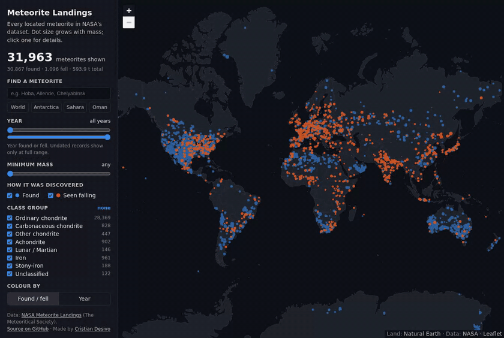
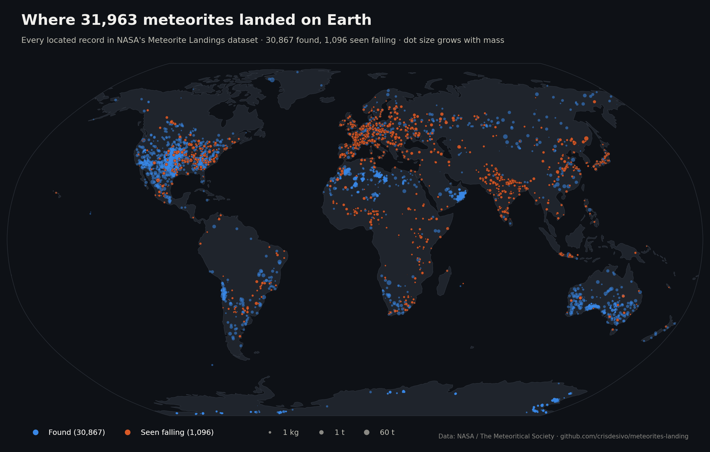

# Meteorite Landings

**Every known meteorite on one map.** I take NASA's Meteorite Landings dataset (45,716 records from The Meteoritical Society), clean it, and put the 31,963 that have usable coordinates on a world map. There's a static map, an interactive one you can filter by year, mass, class and fell/found, and a few numbers that surprised me along the way.

**[Open the live map →](https://crisdesivo.github.io/meteorites-landing/)**



*The interactive map in [`docs/index.html`](docs/index.html): one static page, no server, no API keys.*

## The map



Two patterns stand out:

- **Orange dots (witnessed falls) follow people.** Europe, India, Japan and the eastern US are dense with them, because someone has to see a meteorite fall and report it.
- **Blue dots (finds) follow places where rocks are easy to spot.** The big clusters are in Antarctica, the Sahara (Dar al Gani: 1,045 records, Acfer: 394), Oman (Dhofar: 1,404) and southern Australia: ice and desert, where a dark stone stands out and lasts.

## What the data says

All numbers below are computed by [`meteorites.py`](meteorites.py) and saved to [`data/insights.json`](data/insights.json) every time `build.py` runs.


- **97.6% were found, not seen falling.** That's 44,609 finds against 1,107 witnessed falls.
- **69% of the located meteorites are in Antarctica** (22,099 south of 60°S), and many of the records without coordinates are Antarctic finds too.
- **The catalogue is young: 95% of dated records are from 1970 or later.** Finds jump from a few hundred per decade to 4,909 in the 1970s and 17,698 in the 2000s. Witnessed falls stay flat at 56–91 per decade all through the 20th century.
- **Thousands of finds share a single dot.** Finds are often logged at the coordinates of the ice field they came from: 4,761 records sit at exactly 71.5°S, 35.67°E (the Yamato field), and the 31,963 mapped meteorites share only 17,097 distinct locations. When you click a dot, the interactive map tells you how many records are stacked under it.
- **Stones are common, irons are heavy.** Ordinary chondrites are 87.2% of the records but only 9.8% of the catalogued mass. Irons are 2.3% of the records and 85.0% of the mass.
- **Witnessed falls are much bigger.** The median find weighs 30.5 g, while the median witnessed fall weighs 2.8 kg.
- **The 10 heaviest are all irons,** led by Hoba (60 t, found 1920), Cape York (58.2 t) and Campo del Cielo (50 t). Sikhote-Alin (23 t, 1947) is the only one of the ten that was seen falling.
- **Oldest witnessed fall:** Nogata, in the year 860, followed by Narni (920).

## Cleaning

| Records | Why they are not on the map |
|---:|---|
| 45,716 | in the dataset |
| −7,315 | no coordinates |
| −6,214 | coordinates are the (0, 0) placeholder |
| −1 | *Meridiani Planum*, longitude 354: found **on Mars** by the Opportunity rover |
| −223 | Yamato finds (Antarctica) recorded with latitude 0, which would put them in Kenya |
| **31,963** | **mapped** |

Years outside 800–2016 (one record says 2101) are treated as unknown instead of being dropped. The 466 official classes (`L6`, `CM2`, `Iron, IIIAB`, …) are folded into 8 broad groups for filtering. The rules are in `class_group()` in `meteorites.py`.

## Interactive map

It's live at https://crisdesivo.github.io/meteorites-landing/. Locally, open [`docs/index.html`](docs/index.html) in a browser: it works straight from disk, and any static host can serve `docs/` as-is.

- Filter by year range, minimum mass, found / seen falling and class group. The counter updates live.
- Colour the dots by found/fell or by year.
- Search by name (try *Allende*, *Chelyabinsk* or *Hoba*), or jump to Antarctica, the Sahara or Oman.
- Click a dot for its class, mass, year and coordinates, plus a link to its Meteoritical Bulletin entry.

It's built with [Leaflet](https://leafletjs.com) and a single canvas layer that draws all 31,963 points, so panning and filtering stay smooth. Land and borders come from [Natural Earth](https://www.naturalearthdata.com) and ship with the page, so there's no tile server to break. Web Mercator can't show latitudes beyond 85°S, so 1,423 records near the South Pole sit on the bottom edge of that map. The static map above shows them in place.

## Run it

```bash
pip install -r requirements.txt   # Python 3.12
python build.py                   # add --download to fetch the latest CSV from NASA first
```

That rebuilds the map data, the figures and `data/insights.json` in a few seconds. Then open `docs/index.html`, or run `jupyter notebook notebooks/meteorites.ipynb` for the original exploration.

To re-record the demo GIF (needs `ffmpeg`):

```bash
pip install playwright==1.49.1 && python -m playwright install chromium
python scripts/record_demo.py
```

## Data source and license

- **Meteorite Landings** is published by NASA on [data.nasa.gov](https://data.nasa.gov/dataset/meteorite-landings) ([data.gov listing](https://catalog.data.gov/dataset/meteorite-landings)) and compiled from The Meteoritical Society's [Meteoritical Bulletin Database](https://www.lpi.usra.edu/meteor/). The CSV in `data/` is NASA's file, unmodified ([direct link](https://data.nasa.gov/docs/legacy/meteorite_landings/Meteorite_Landings.csv)), downloaded in October 2026. It is listed as a public dataset with no specific license attached. If you reuse it, credit NASA and The Meteoritical Society.
- **Basemap**: Natural Earth 1:50m land and borders (public domain).

## Structure

```
meteorites.py              load, clean, classify and summarise the data (single source of truth)
build.py                   regenerates everything below from data/Meteorite_Landings.csv
data/
  Meteorite_Landings.csv   raw NASA dataset (45,716 rows)
  insights.json            every number quoted in this README
docs/                      the interactive map (static site)
  index.html, app.js, style.css
  data/meteorites.js       compact map data (generated)
  data/basemap.js          Natural Earth outlines (generated)
notebooks/meteorites.ipynb the original exploration, re-run on the cleaned data
scripts/record_demo.py     headless-browser recording of assets/demo.gif
assets/                    map.png, insights.png, demo.gif, interactive.png
```

---

Made by Cristian Desivo — https://cristiandesivo.com
